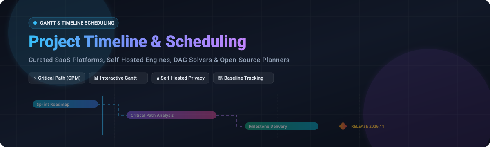

# Awesome-Project-Timeline-Scheduling-Software

  

**🚀 A Curated Directory of SaaS Platforms, Enterprise Solutions & Open-Source Timeline / Gantt Scheduling Tools**  
*Comprehensive benchmarking covering interactive Gantt charts, critical path method (CPM) engines, baseline tracking, dependency management, and self-hosted scheduling planners.*

---

## 📌 Executive Summary & Architecture

Project timeline and scheduling software forms the operational backbone for engineering teams, PMOs, general contractors, and digital agencies. Modern timeline engines convert complex work breakdown structures (WBS) into visual roadmaps, calculate critical paths via topological sorting algorithms (DAGs), monitor resource contention, and track baseline variances across enterprise project portfolios.

This guide benchmarks both leading commercial SaaS vendors and self-hosted open-source repositories to help teams select the optimal balance between managed collaboration, data governance, and architectural flexibility.

---

## 📑 Table of Contents

- [📊 Sector Overview & Market Dynamics](#-sector-overview--market-dynamics)
- [☁️ SaaS & Hosted Enterprise Platforms](#️-saas--hosted-enterprise-platforms)
- [💻 Open-Source GitHub Projects & Libraries](#-open-source-github-projects--libraries)
- [🛠️ Architectural & Implementation Tradeoffs](#️-architectural--implementation-tradeoffs)
- [💖 Support & Sponsorship](#-support--sponsorship)
- [📈 Star History](#-star-history)
- [🤝 How to Contribute](#-how-to-contribute)
- [⚖️ License & Community Governance](#️-license--community-governance)

---

## 📊 Sector Overview & Market Dynamics

The global project management and scheduling software market is estimated at **$7.5 billion to $9.8 billion in 2026**, projected to exceed **$15 billion by 2030** with an annual compound growth rate (CAGR) of ~10.5%–12.0%. 

The sector is **moderately fragmented**: mega-cap ecosystem incumbents (such as Microsoft 365 / Planner, Atlassian, and enterprise ERPs) control foundational enterprise footprints, while a dynamic tier of high-growth modern collaborative Work Management (CWM) vendors (Monday.com, Smartsheet, ClickUp, Asana, Wrike) fiercely compete on workflow customization, AI automation, and intuitive timeline UX without a single winner-take-all monopoly. Simultaneously, specialized niche planners and developer-first open-source engines capture significant self-hosted demand driven by strict data sovereignty and custom on-premise workflow needs.

---

## ☁️ SaaS & Hosted Enterprise Platforms

The table below lists top commercial SaaS and cloud-hosted project timeline & scheduling platforms, ranked in descending order by parent company scale (valuation or enterprise revenue), complete with verified entry-tier pricing models and exact free plan / trial limitations.

| Platform | Company Scale (Valuation / Revenue) | Starting Tier Pricing | Free Tier / Trial Limits | Core Timeline & Scheduling Capabilities |
| :--- | :--- | :--- | :--- | :--- |
| **[Microsoft Project](https://www.microsoft.com/en-us/microsoft-365/project/project-management-software)** | ~$3.1 Trillion market cap (Microsoft Corporation) | **$10.00 / user / month** (Planner and Project Plan 1, billed annually) | **30-day free trial**; requires enterprise Microsoft account; up to 25 user trial seats; no permanent free tier | Industry-standard CPM scheduling engine, WBS hierarchical breakdown, automated scheduling, baseline tracking, and native Power BI / M365 integration. |
| **[Gantt Chart for Jira](https://marketplace.atlassian.com/)** | ~$48 Billion market cap (Atlassian Corporation) | **$1.50 / user / month** (Starting at $15/mo for up to 10 users via Atlassian Marketplace) | **Free forever up to 10 users** on Jira Cloud; 30-day free evaluation trial for larger team tiers | Native Jira integration, live two-way sync with Jira issues/sprints, automated dependency linking (FS, SS, FF, SF), and critical path computation. |
| **[Smartsheet](https://www.smartsheet.com/)** | ~$8.4 Billion valuation (Acquired by Blackstone & Vista Equity, 2024–2025) | **$9.00 / user / month** (Pro tier, billed annually; max 10 users) | **Free forever plan limited to 1 user and up to 2 sheets** (500MB storage); 30-day full-feature trial with unlimited sheets | Grid-driven Gantt scheduling with auto-lag/lead calculations, baseline comparisons, roll-up summary milestones, and multi-sheet dependencies. |
| **[Monday.com](https://monday.com/)** | ~$13.5 Billion market cap (NASDAQ: MNDY; ~$970M+ ARR) | **$9.00 / seat / month** (Standard tier, billed annually; Gantt view requires Standard, min 3 seats = $27/mo) | **Free forever plan for up to 2 users and 3 boards** (Gantt view excluded; free tier limited to Kanban/List); 14-day Pro free trial with Gantt | Highly customizable Work OS boards with visual Timeline/Gantt columns, task dependencies, workload leveling, and drag-and-drop schedule adjusting. |
| **[Asana](https://asana.com/)** | ~$3.2 Billion market cap (NYSE: ASAN; ~$700M+ ARR) | **$10.99 / user / month** (Starter tier, billed annually; Timeline view requires Starter) | **Free forever plan (Personal) for up to 10 users** (limited to List, Board, and Calendar views; excludes Timeline view); 30-day Starter/Advanced trial | High-level interactive Timeline view with drag-and-drop date shifting, dependency conflict flags, and cross-team milestone roadmaps. |
| **[Wrike](https://www.wrike.com/)** | ~$2.25 Billion valuation (STG Partners; ~$200M+ revenue) | **$9.80 / user / month** (Team tier, billed annually, 2–25 users) | **Free forever plan for unlimited users** (limited to basic board/table views and 2GB cloud storage; excludes Gantt); 14-day full business trial | Dynamic Interactive Gantt charts, snapshot baselines, critical path analysis, lead/lag adjustment, and cross-project portfolio timeline rollups. |
| **[ClickUp](https://clickup.com/)** | ~$4.0 Billion valuation (Series C; ~$160M+ ARR) | **$7.00 / user / month** (Unlimited tier, billed annually) | **Free forever plan with 100MB storage and 100 Gantt chart uses**; 14-day full trial of Business plan | All-in-one productivity suite with interactive Gantt view, 4 dependency types, slack time calculation, critical path highlighting, and cascading rescheduling. |
| **[GanttPRO](https://ganttpro.com/)** | Private (~$10M–$25M ARR; 850k+ registered users) | **$7.99 / user / month** (Basic plan, billed annually; min 1 seat) | **14-day free trial** with full Pro feature access (unlimited projects, 1 user); no permanent free tier | Focused online Gantt software with auto-scheduling, critical path calculation, baseline comparison, project portfolio tracking, and MS Project file imports. |
| **[TeamGantt](https://www.teamgantt.com/)** | Private (~$8M–$20M ARR; Bootstrapped & profitable) | **$19.00 / manager / month** (Lite plan, billed annually; includes 5 collaborators per manager) | **Free forever plan limited to 1 manager, 1 project, and up to 60 tasks**; 30-day trial of Advanced Pro tier | Dedicated collaborative Gantt chart builder, drag-and-drop timeline adjustments, workload/resource management, and client embeddable view links. |
| **[Instagantt](https://instagantt.com/)** | Private (~$3M–$10M ARR) | **$12.00 / user / month** (Single user plan; or $24/mo for 3-user team pack, billed annually) | **7-day free trial** with full access for 1 user and up to 3 projects; no permanent free tier | Dedicated Gantt timeline engine with native bi-directional sync for Asana and Trello, critical path visualization, task baselines, and public link sharing. |

---

## 💻 Open-Source GitHub Projects & Libraries

Open-source project timeline software spans end-to-end self-hosted management platforms, purpose-built Gantt planners, and developer-first JavaScript/React visualization engines. 

The repositories below are ranked in descending order by **GitHub Star Count**:

| Repository / Project | Stars | Tech Stack & License | Key Capabilities & Use Cases |
| :--- | :---: | :--- | :--- |
| **[makeplane/plane](https://github.com/makeplane/plane)** |  | Python, Next.js, AGPL-3.0 | Modern open-source Jira/Linear alternative. Includes workspace Gantt and timeline views, issue cycles, modules, task dependencies, and self-hosted Docker deployment. |
| **[odoo/odoo](https://github.com/odoo/odoo)** |  | Python, JavaScript, LGPL-3.0 | Comprehensive ERP ecosystem. The Odoo Project app delivers native Gantt timelines, resource allocation, milestone dependencies, timesheet tracking, and customer invoicing. |
| **[mattermost/focalboard](https://github.com/mattermost/focalboard)** |  | TypeScript, Go, AGPL-3.0 | Open-source alternative to Trello, Notion, and Asana. Features multi-view boards with interactive Timeline/Gantt views, date grouping, task milestones, and self-hosted privacy. |
| **[opf/openproject](https://github.com/opf/openproject)** |  | Ruby on Rails, Angular, GPL-3.0 | The leading enterprise open-source project management platform. Features native interactive Gantt charts, CPM critical path highlighting, baseline variance, and multi-project hierarchy. |
| **[plankanban/planka](https://github.com/plankanban/planka)** |  | React, Redux, Node.js, AGPL-3.0 | Elegant real-time collaborative project management system for agile teams with task timelines, deadlines, custom card fields, and self-hosted microservice Docker support. |
| **[Leantime/leantime](https://github.com/Leantime/leantime)** |  | PHP, JavaScript, AGPL-3.0 | Purpose-built system combining design thinking with Lean and Agile execution. Includes milestone Gantt views, roadmap planning, task dependencies, and sprint tracking. |
| **[usekaneo/kaneo](https://github.com/usekaneo/kaneo)** |  | TypeScript, React, Node.js, AGPL-3.0 | Modern lightweight project management platform built to minimize friction. Features interactive Gantt charts, drag-and-drop board views, and GitHub issue synchronizations. |
| **[frappe/gantt](https://github.com/frappe/gantt)** |  | JavaScript, CSS, SVG, Apache-2.0 | Lightweight, dependency-free interactive SVG Gantt chart web library. Supports drag-and-drop resizing, dynamic date modes (Quarter Day through Year), and custom HTML tooltips. |
| **[redmine/redmine](https://github.com/redmine/redmine)** |  | Ruby on Rails, GPL-2.0 | Classic open-source project management and issue tracker with built-in Gantt timelines, calendar views, issue tracking, and a rich ecosystem of third-party scheduling plugins. |
| **[go-vikunja/vikunja](https://github.com/go-vikunja/vikunja)** |  | Go, Vue.js, AGPL-3.0 | Self-hosted task and project management suite with end-to-end task timelines, Gantt overview visualization, task relationships, repeating tasks, and CalDAV sync. |
| **[AhmadHassan-BTed/Jantt](https://github.com/AhmadHassan-BTed/Jantt)** |  | JavaScript, React, MIT | AI-native JSON Gantt chart engine featuring a zero-dependency topological DAG solver, interactive timeline canvas, formal JSON schema, and standalone CLI. |
| **[mark-when/markwhen](https://github.com/mark-when/markwhen)** |  | TypeScript, Vue.js, MIT | Markdown-based timeline and cascading Gantt generator. Converts simple, human-readable plain text notes into interactive Gantt charts and project calendar timelines. |
| **[neuronetio/gantt-schedule-timeline-calendar](https://github.com/neuronetio/gantt-schedule-timeline-calendar)** |  | TypeScript, Svelte/JS, AGPL-3.0 | High-performance, virtualized timeline calendar component capable of rendering thousands of concurrent tasks, reservations, tree hierarchies, and elastic time scales. |
| **[robicch/jQueryGantt](https://github.com/robicch/jQueryGantt)** |  | JavaScript, CSS, MIT | Battle-tested client-side Gantt editor component developed by Twproject. Includes full in-place editing, task dependency links, zooming, and JSON import/export. |
| **[DHTMLX/gantt](https://github.com/DHTMLX/gantt)** |  | JavaScript, GPL-2.0 (Community) | Ultra-fast client-side Gantt component supporting cross-browser rendering, drag-and-drop task linking, milestones, auto-scheduling hooks, and export utilities. |
| **[croffasia/itsaplan](https://github.com/croffasia/itsaplan)** |  | TypeScript, React, AGPL-3.0 | Modern self-hosted Linear/Plane alternative designed for engineering teams and AI agents with interactive timeline views and issue roadmap management. |
| **[bardsoftware/ganttproject](https://github.com/bardsoftware/ganttproject)** |  | Java, Swing, GPL-3.0 | Mature open-source desktop scheduling application. Supports WBS creation, task dependency relations, baseline tracking, resource load charts, and PDF/MS Project exports. |
| **[MaTeMaTuK/gantt-task-react](https://github.com/MaTeMaTuK/gantt-task-react)** |  | TypeScript, React, MIT | Interactive Gantt chart component for React with virtualized row rendering, custom milestone styles, dependency lines, and touch/drag event handlers. |
| **[taskjuggler/TaskJuggler](https://github.com/taskjuggler/TaskJuggler)** |  | Ruby, GPL-2.0 | Programmatic, text-driven project planning tool. Computes optimal task timelines, critical paths, and resource assignments using declarative constraint programming. |
| **[zunnzunn/vue-ganttastic](https://github.com/zunnzunn/vue-ganttastic)** |  | TypeScript, Vue 3, MIT | Simple, interactive, and customizable Gantt chart component for Vue 3 with horizontal drag-and-drop, snapping increments, and responsive layout styling. |
| **[smartqubit/projectlibre](https://github.com/smartqubit/projectlibre)** |  | Java, CPAL-1.0 | Open-source Microsoft Project alternative. Provides traditional desktop Gantt scheduling, earned value management (EVM), PERT charts, and WBS resource costing. |
| **[tiohsa/redmine_canvas_gantt](https://github.com/tiohsa/redmine_canvas_gantt)** |  | Ruby, JavaScript, MIT | Lightweight canvas-rendered Gantt chart plugin for Redmine requiring zero database migrations. Delivers smooth panning and zoom rendering for dense project schedules. |
| **[vakahnke/seedcorn](https://github.com/vakahnke/seedcorn)** |  | Python 3.12, Django, React 19, Apache-2.0 | Dedicated self-hosted Gantt planner. Features HTML canvas timeline rendering, MS Project XML schema validation, reusable plan templates, and one-click PowerPoint slide generation. |
| **[imasdetres/redmine_easy_gantt](https://github.com/imasdetres/redmine_easy_gantt)** |  | Ruby, JavaScript, GPL-2.0 | Interactive drag-and-drop Redmine Gantt plugin. Features critical path highlighting, baseline comparisons, milestone delay notifications, and multi-project portfolio views. |

---

## 🛠️ Architectural & Implementation Tradeoffs

When designing or adopting a project timeline and scheduling architecture, engineering and PMO teams typically evaluate three primary paradigms:

### 1. ⚙️ Dedicated Scheduling Engines vs. Generalized Work Suites
- **Dedicated Planners (Microsoft Project, GanttPRO, Seedcorn, GanttProject)**: Implement strict Critical Path Method (CPM) math, forward/backward pass algorithms, resource leveling heuristics, and rigid Finish-to-Start (FS), Start-to-Start (SS), Finish-to-Finish (FF), and Start-to-Finish (SF) constraints with lead/lag.
- **Collaborative Work Suites (Plane, Monday.com, ClickUp, Asana)**: Treat timeline/Gantt views as a presentation layer over Kanban or issue cards. These provide superior team engagement and communication, but may lack automatic cascading recalculations when dates slip.

### 2. 🎨 Canvas Rendering vs. DOM/SVG Visualization
- **DOM / SVG Tree Implementations (`frappe/gantt`, standard React tables)**: Easier to inspect, style with standard CSS, and bind event handlers to, but can experience DOM thrashing and lag when timelines scale beyond 500+ concurrent tasks.
- **HTML Canvas / WebGL Engines (`Seedcorn`, `tiohsa/redmine_canvas_gantt`, virtualized grids)**: Retain 60 FPS performance during smooth panning and zooming across multi-year portfolios containing thousands of tasks.

### 3. 🛡️ Data Governance & Compliance
- Teams working under defense, banking, or healthcare regulations often mandate **self-hosted on-premise deployments** (`OpenProject`, `Leantime`, `Plane`, or `Redmine`), guaranteeing that proprietary milestone schedules and subcontractor records never touch multi-tenant commercial cloud environments.

---

## 💖 Support & Sponsorship

Thank you for exploring and bookmarking **Awesome Project Timeline & Scheduling Software**! ✨  
If this curated list saved you research time or assisted your team in evaluating project scheduling architecture, please consider showing your support:

- ⭐ **Star this repository** to improve discoverability for other developers and project managers.
- 🍴 **Fork and contribute** tools, pricing updates, or documentation enhancements.
- 📣 **Share it** with your network on LinkedIn, Twitter/X, Reddit, or relevant tech communities.
- ☕ **Buy a coffee or become a sponsor**: Support independent open-source curation and maintenance directly via the [GitHub Sponsor Dashboard](https://github.com/sponsors/ishandutta2007).

---

## 📈 Star History

---

## 🤝 How to Contribute

We welcome community contributions! To add a new platform, update pricing tiers, or suggest new open-source repositories:

1. Fork this repository: `https://github.com/ishandutta2007/Awesome-Project-Timeline-Scheduling-Software`
2. Create a feature branch: `git checkout -b feature/add-new-scheduling-tool`
3. Add your tool following the existing table formatting:
   - For SaaS: Name, official URL, parent company scale/valuation, exact starting tier pricing, and explicit free limits.
   - For Open-Source: Name, GitHub repository link, real-time star badge (linking to stargazers), stack/license, and capabilities.
4. Verify table sorting (SaaS sorted descending by scale; Open-Source sorted descending by GitHub stars).
5. Open a Pull Request with a clear description of changes.

---

## ⚖️ License & Community Governance

- This list is licensed under the [Creative Commons Zero v1.0 Universal](LICENSE) (CC0 1.0) Public Domain Dedication.
- Product names, trademarks, and logos belong to their respective corporate owners and are utilized here strictly for identification, reference, and educational purposes.
